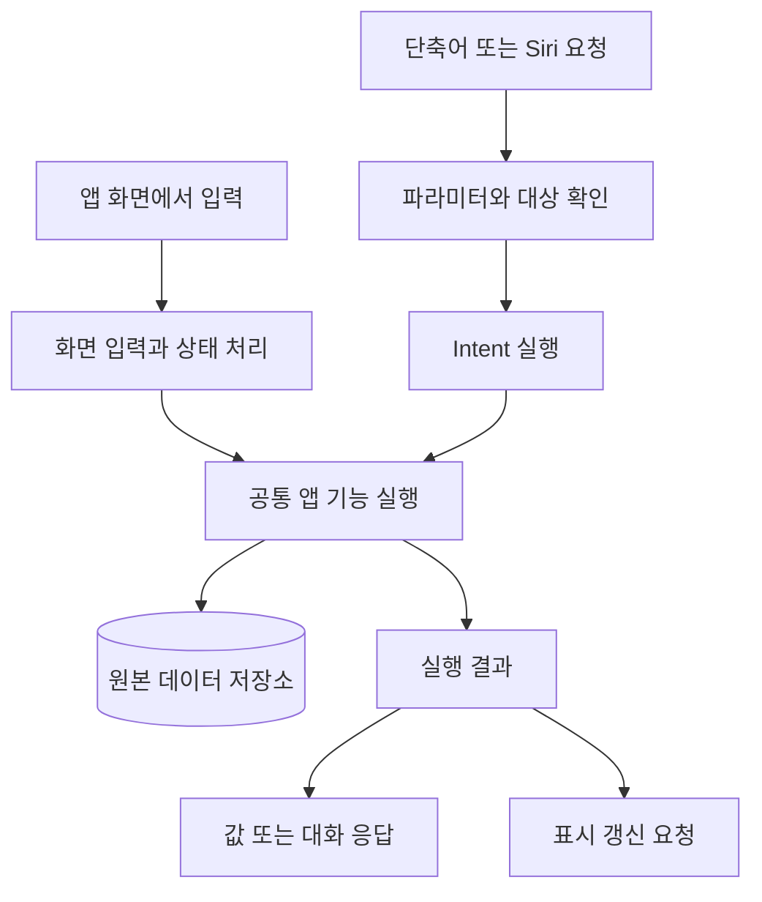
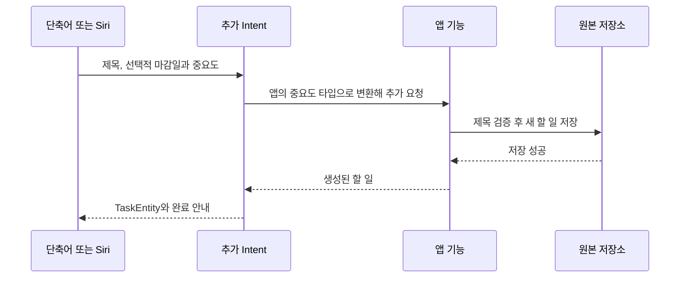
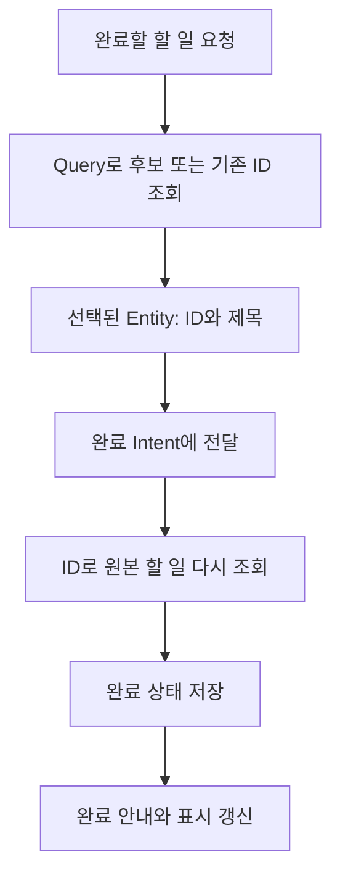
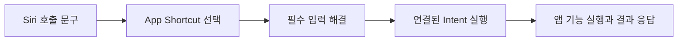
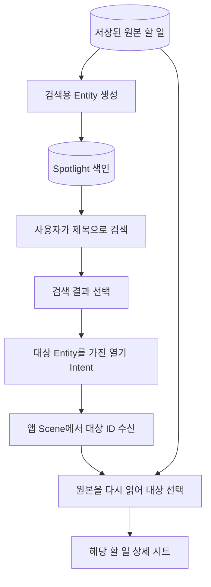
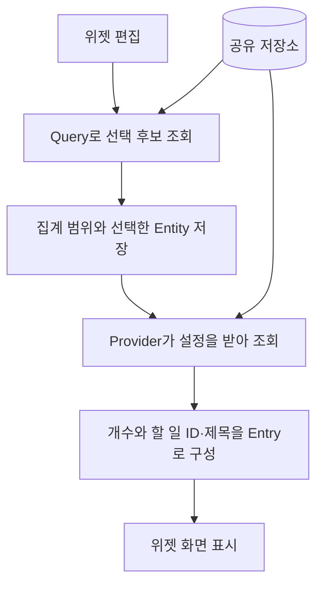
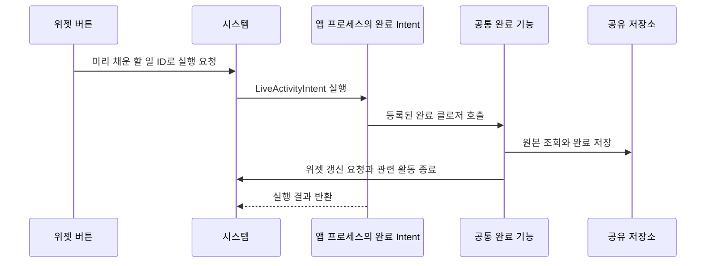
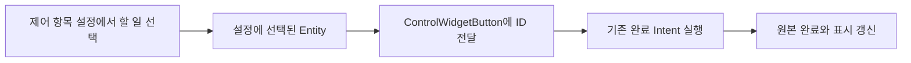
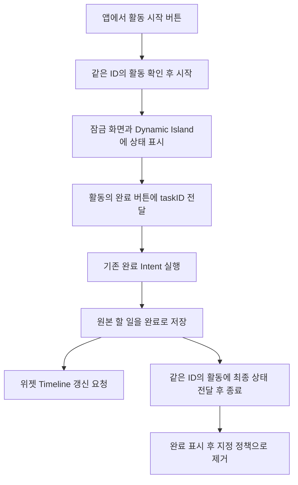
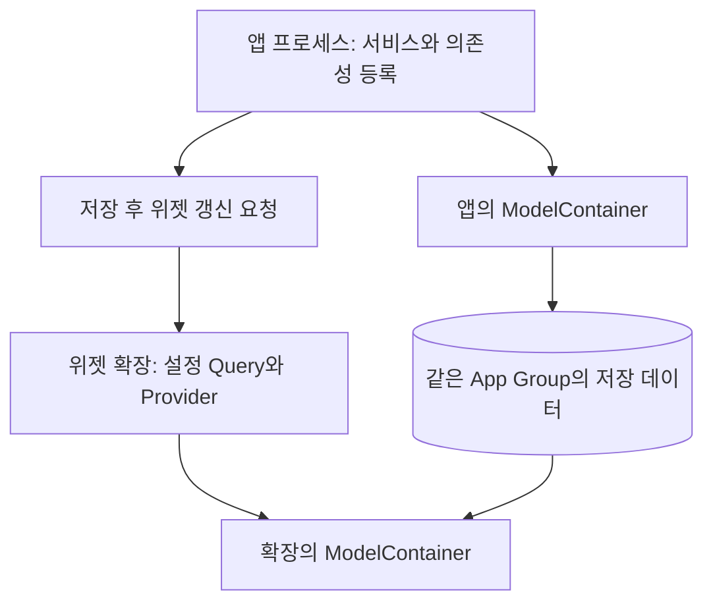

# AppIntents

**할 일 앱으로 배우는 App Intents: 앱의 기능을 단축어, Siri, Spotlight, 위젯으로 연결하기**

앱 안에서 할 일을 추가할 수 있다면, 같은 기능을 Siri에게 부탁하거나 위젯에서 실행할 수도 있을까요?
이 프로젝트는 작은 할 일 앱의 기능을 여러 시스템 진입점에 연결하며 그 과정을 배우는 iOS 실습입니다.

핵심은 <b>"입구가 달라져도 같은 앱 기능과 같은 저장 데이터를 사용한다"</b>는 것입니다.
이 문서에서는 폴더 구조보다 **실행 요청 → 입력과 대상 찾기 → 앱 기능 실행 → 결과 전달과 표시 갱신**을 중심으로 설명합니다.
Swift의 기본 문법, `async/await`, SwiftUI의 상태 개념을 알고 있다면 3절의 첫 Intent부터 시작할 수 있습니다. SwiftData는 4절의 원본 모델, WidgetKit·App Extension·App Group은 7절, ActivityKit은 9절에서 필요할 때 살펴보면 됩니다. 이 기술들을 먼저 모두 익혀야 하는 것은 아닙니다.

### 먼저 읽을 경로

처음부터 모든 API를 외우려고 읽지 않아도 됩니다. 각 단계의 실습을 마친 뒤 다음 단계로 넘어가세요.

| 단계 | 읽을 곳 | 이번 단계에서 붙잡을 질문 |
|---|---|---|
| 1. 첫 동작 | 2절의 개념 표 → 3절 | 입력을 받아 `perform()`에서 무엇을 하고, 무엇을 돌려주나? |
| 2. 앱 데이터 | 4절 | 시스템은 저장된 할 일 중 **어느 것**을 어떻게 찾나? |
| 3. 호출 입구 | 5절 | 이 동작을 단축어·Siri에서 어떻게 찾나? |
| 4. 콘텐츠 열기 | 6절 | 검색한 할 일을 앱의 해당 화면으로 어떻게 연결하나? |
| 5. 다른 화면 | 7~9절 | 위젯·제어 센터·Live Activity는 같은 완료 기능을 어떻게 쓰나? |
| 6. 내부 구조 | 10절 | 앱과 확장은 저장 데이터를 어떻게 공유하나? |

3절까지 읽었다면 App Intents의 가장 작은 흐름을 익힌 것입니다. 7~10절은 같은 흐름을 여러 시스템 화면으로 넓히는 실전 편입니다.

### 이 문서의 실행 기준

이 README는 **Xcode 27.0 · iOS 27.0 SDK · 프로젝트 Deployment Target iOS 27.0**에서 확인한 코드 기준입니다. `AppIntents.xcodeproj`의 `AppIntents` Scheme으로 앱을 실행합니다. 표의 최소 버전은 Xcode 27 SDK에 선언된 **API별 도입 버전**이고, 이 프로젝트 전체의 실행 최소 버전은 **iOS 27.0**입니다. Siri·Dynamic Island 동작은 기기와 언어에 따라 별도로 확인해야 합니다.

<details>
<summary>기능별 타깃과 iOS 지원 버전 보기</summary>

| 기능 | 핵심 API | 이 예제의 코드 타깃 | 주로 실행되는 곳 | 주요 API의 iOS 최소 버전 |
|---|---|---|---|---|
| 기본 동작·App Shortcut | `AppIntent`, `AppShortcutsProvider` | 앱 | 시스템 요청을 받아 앱 코드 실행 | 16.0 |
| Spotlight Entity | `IndexedEntity` | 앱 | 앱에서 색인 요청, 시스템에서 검색 | 18.0 |
| 할 일 화면 열기 | `TargetContentProvidingIntent`, `.system.open` 스키마 | 앱 | 앱 Scene | 26.0 / 스키마는 27.0 |
| 설정 가능한 위젯 | `WidgetConfigurationIntent`, `AppIntentTimelineProvider` | 위젯 확장 | 위젯 확장 | 17.0 |
| 제어 센터 | `ControlWidget`, `ControlConfigurationIntent` | 위젯 확장 | 시스템 화면과 위젯 확장 | 18.0 |
| Live Activity | `ActivityKit`, `LiveActivityIntent` | 앱과 위젯 확장 | 앱의 실행 코드와 시스템 표시 | 16.1 / Intent는 17.0 |

표의 실행 위치는 **이 예제의 주된 경로**입니다. 일반 `AppIntent` 전체가 항상 앱 프로세스에서 실행된다는 뜻은 아닙니다. 위젯의 버튼 경로는 7절에서 따로 설명합니다.

</details>

## 목차

1. [구현 범위](#start)
2. [먼저 알아둘 개념과 전체 흐름](#concepts)
3. [할 일 추가: 입력을 받아 결과 돌려주기](#add)
4. [할 일 선택과 완료: Entity와 Query](#entity)
5. [Siri와 App Shortcuts: 실행할 입구 제공하기](#shortcuts)
6. [Spotlight와 화면 열기: 검색에서 앱 콘텐츠까지](#spotlight)
7. [위젯: 설정, 표시, 실행 나누기](#widget)
8. [제어 센터: 같은 완료 동작 재사용하기](#control)
9. [Live Activity: 저장 상태와 표시 상태 연결하기](#activity)
10. [프로세스와 공유 저장소 이해하기](#sharing)

<a id="start"></a>

## 1. 구현 범위

처음 읽을 때는 표에서 **할 일 추가** 행만 보고 3절로 가도 됩니다. 나머지는 뒤 절에서 하나씩 연결됩니다.

실습할 때는 `AppIntents.xcodeproj`를 열고 `AppIntents` Scheme으로 앱을 설치한 뒤 제목이 다른 할 일 두 개를 만드세요. 위젯까지 실행한다면 앱·위젯 확장 타깃의 App Group 설정과 `TaskModelContainer.make()`의 식별자가 일치해야 합니다. 현재 프로젝트의 식별자는 `group.com.theo.AppIntents`입니다.

### 구현한 기능

| 사용자가 하는 일 | 연결한 App Intents 요소 | 현재 범위 |
|---|---|---|
| 할 일 추가 | `AddTaskIntent`, `@Parameter`, `AppEnum`, `ReturnsValue` | 제목·선택적 마감일·중요도를 저장하고 `TaskEntity` 반환 |
| 할 일 선택·검색 | `TaskEntity`, `EntityStringQuery` | ID로 다시 찾기, 제목 검색, 선택 후보 제공 |
| 할 일 완료 | `CompleteTaskIntent` | ID로 원본을 조회한 뒤 완료 저장, 대화 응답 |
| Siri에서 호출 | `TaskAppShortcuts` | 추가·완료 App Shortcut 제공 |
| Spotlight에서 찾기 | `IndexedEntity`, `IndexedEntityQuery` | 제목 색인, 기존 데이터 색인, 재색인 처리 |
| 특정 할 일 열기 | `OpenIntent`, `TargetContentProvidingIntent` | 선택한 할 일의 상세 시트 표시 |
| 열기 동작의 의미 설명 | `@AppIntent(schema: .system.open)` | 스키마 적용. 스키마 기반 Siri 자연어 호출은 미검증 |
| 홈 화면에서 개수·할 일 보기 | `WidgetConfigurationIntent`, `AppIntentTimelineProvider` | 집계 범위와 표시할 할 일 설정 |
| 홈 화면에서 완료하기 | `Button(intent:)`, `LiveActivityIntent` | 위젯에 표시된 할 일 완료 |
| 제어 센터에서 완료하기 | `ControlConfigurationIntent`, `ControlWidgetButton` | 미리 선택한 할 일 완료 |
| 잠금 화면·Dynamic Island에서 완료하기 | `LiveActivityIntent`, `ActivityKit` | 앱에서 활동 시작, 활동의 완료 버튼, 완료 시 종료 |

앱 화면의 추가 입력은 현재 **제목만** 받습니다. 마감일·중요도 입력은 `AddTaskIntent`에서 실습하고, 앱에서는 저장된 값을 확인합니다.
현재 `TaskListView`에는 별도 완료 버튼이 없으므로 완료는 단축어·위젯·제어 센터·Live Activity에서 실습합니다.
Live Activity는 할 일의 진행/완료 상태를 보여주며, 집중 타이머 기능은 구현되어 있지 않습니다.

<a id="concepts"></a>

## 2. 먼저 알아둘 개념과 전체 흐름

“보고서 작성을 완료해 줘”라는 요청에는 **무엇을 할지**와 **어떤 데이터를 대상으로 할지**가 함께 들어 있습니다.

| 개념 | 쉬운 설명 | 이 프로젝트의 예 |
|---|---|---|
| `AppIntent` | 시스템에 공개하는 실행 가능한 동작 | 할 일 추가·완료 |
| `@Parameter` | 동작을 실행할 때 필요한 입력 | 제목, 마감일, 대상 할 일 |
| `AppEnum` | 미리 정해진 선택지 | 높음·보통·낮음 |
| `AppEntity` | 시스템이 식별하고 표시할 수 있는 앱 데이터의 표현 | 할 일 ID와 제목 |
| `EntityQuery` | ID 등으로 실제 Entity를 찾아 돌려주는 조회 규칙 | 저장된 할 일 검색 |
| `AppShortcut` | Intent를 쉽게 발견하고 호출하도록 제공하는 입구 | “앱 이름에서 할 일 추가” |
| `perform()` | 입력이 준비된 뒤 앱 동작을 실행하는 지점 | 서비스의 추가·완료 메서드 호출 |
| 결과 값 / Dialog | 다음 동작에 넘길 데이터 / 사용자에게 할 말 | 생성된 Entity / “추가했어요” |

App Intents는 앱이 무엇을 할 수 있는지 시스템에 설명하고, 시스템의 요청을 앱 코드에 연결합니다.
필수 입력을 해결한 뒤 `perform()`이 실행되는 것이 기본 흐름입니다. [Apple: 첫 App Intent 만들기](https://developer.apple.com/documentation/appintents/creating-your-first-app-intent)



예제에서는 공통 기능이 `TaskService`, 저장 접근이 `TaskRepository`입니다.
앱 화면은 ViewModel을 통해 서비스를 호출하고 Intent는 바로 서비스를 호출합니다.
이 분리는 MVVM이라는 이름보다 **제목 검증·저장·완료 규칙을 여러 입구에서 함께 쓴다**는 점이 중요합니다.

처음에는 `TaskService`를 **할 일을 저장·완료하는 앱 내부 기능**으로만 생각해도 충분합니다. `@Dependency`는 Intent가 앱 내부의 기능 객체를 사용할 수 있도록 연결하는 방법입니다. 이 예제에서는 미리 등록한 `TaskService`를 가져옵니다. 등록 과정은 10절에서 자세히 살펴봅니다.

<a id="add"></a>

## 3. 할 일 추가: 입력을 받아 결과 돌려주기

첫 번째 읽기에서는 `taskTitle` 입력, `service.addTask(...)` 호출, `return .result(...)` 세 지점만 따라가세요. 중요도 `AppEnum`과 Spotlight 색인은 두 번째 읽기에서 살펴봐도 흐름을 이해하는 데 지장이 없습니다.

### 사용 상황과 데이터 흐름

단축어에서 제목 `우유 사기`, 중요도 `높음`을 입력합니다.
Intent가 이 입력을 앱의 자료형으로 바꾸고, 서비스가 저장한 뒤 새 할 일의 Entity를 돌려줍니다.



### 실행에 필요한 입력을 선언한다

`AppIntents/Features/Tasks/Intents/AddTaskIntent.swift`
```swift
@Parameter(title: "할 일 제목")
var taskTitle: String

@Parameter(title: "마감일")
var dueDate: Date?

@Parameter(title: "중요도")
var priority: TaskPriorityOption?
```

**App Intents 핵심:** `@Parameter`는 Intent 실행에 필요한 입력을 시스템에 공개합니다. 단축어에서는 편집할 수 있는 입력 UI로 나타나고, Siri에서는 질문을 통해 값을 채울 수 있습니다. 이 코드에서는 제목이 필수이고 마감일·중요도는 선택 입력입니다.

`AppIntents/Features/Tasks/Intents/AddTaskIntent.swift`
```swift
static var parameterSummary: some ParameterSummary {
    Summary("할 일 \(\.$taskTitle) 추가") {
        \.$dueDate
        \.$priority
    }
}
```

`parameterSummary`의 `\.$taskTitle`은 위에서 선언한 **제목 입력 칸을 가리킵니다**. 단축어 편집 화면에서는 이를 이용해 “할 일 [제목] 추가”라는 문장으로 동작을 보여주고, 마감일·중요도도 편집할 수 있게 합니다. Siri 호출 문구는 별도로 정의합니다.
값이 아예 없는 경우와 공백 문자열이 들어온 경우도 다릅니다. 후자는 서비스가 검증합니다.

### 정해진 선택지는 AppEnum으로 표현한다

`AppIntents/Features/Tasks/Intents/TaskPriorityOption.swift`
```swift
enum TaskPriorityOption: String, AppEnum {
    case high
    case normal
    case low

    static let typeDisplayRepresentation: TypeDisplayRepresentation = "중요도"

    static let caseDisplayRepresentations: [Self : DisplayRepresentation] = [
        .high: "높음",
        .normal: "보통",
        .low: "낮음"
    ]
}
```

`TaskPriorityOption`은 시스템 입력용 타입이고 `TaskPriority`는 앱의 저장 모델에서 사용하는 타입입니다.
`caseDisplayRepresentations` 덕분에 단축어에서 사용자는 영어 코드 이름인 `high` 대신 `높음`을 봅니다. 이 예제에서는 입력 타입과 저장 타입을 분리하고 `perform()`에서 변환합니다. 중요도를 생략하면 `.normal`로 처리합니다.

`AppIntents/Features/Tasks/Intents/AddTaskIntent.swift`
```swift
@MainActor
func perform() async throws -> some IntentResult & ProvidesDialog & ReturnsValue<TaskEntity> {
    do {
        let taskPriority: TaskPriority

        switch priority {
        case .some(.high):
            taskPriority = .high
        case .some(.low):
            taskPriority = .low
        case .some(.normal), .none:
            taskPriority = .normal
        }

        let createdTask = try await service.addTask(title: taskTitle, dueDate: dueDate, priority: taskPriority)

        return .result(
            value: TaskEntity(task: createdTask),
            dialog: "할 일을 추가했어요."
        )
    } catch TaskServiceError.emptyTitle {
        throw AppIntentError(description: "할 일 제목을 입력해주세요.")
    }
}
```

`perform()`은 입력이 준비된 뒤 호출됩니다. `switch priority`는 `TaskPriorityOption?`을 저장 모델의 `TaskPriority`로 바꾸며, `.none`에도 기본값인 `.normal`을 줍니다. 그다음 `service.addTask(...)`가 저장을 맡습니다. 저장에 성공해야 `createdTask`를 결과로 만들 수 있습니다.

**이 예제의 설계:** `@MainActor`는 모든 `AppIntent.perform()`에 붙여야 하는 규칙이 아닙니다. 여기서는 `TaskService`와 SwiftData의 `mainContext` 접근이 메인 액터에 묶여 있어 맞춘 것입니다.

여기서 반환하는 것은 두 종류입니다.

- `value: TaskEntity(...)`: 새 할 일의 ID·제목을 다음 단축어 동작에 전달합니다. 반환형의 `ReturnsValue<TaskEntity>`가 이 계약을 나타냅니다.
- `dialog: ...`: 사용자에게 “할 일을 추가했어요”라고 알립니다. 반환형의 `ProvidesDialog`가 이 계약을 나타냅니다.

예를 들어 단축어에서 `할 일 추가`의 결과 값을 다음 `할 일 완료`의 대상에 넣어 **추가 → 방금 추가한 할 일 완료**로 연결할 수 있습니다.
현재 Entity에는 ID와 제목만 들어 있으므로 원본 모델의 모든 속성이 반환되는 것은 아닙니다.
제목이 공백이라 서비스가 `emptyTitle`을 던지면 `catch`에서 사람이 이해할 수 있는 `AppIntentError`로 바꿉니다. 이때 결과 값은 반환되지 않습니다.

### 저장과 검증은 공통 서비스에서 한다

`AppIntents/Core/Services/TaskService.swift`
```swift
func addTask(title: String, dueDate: Date? = nil, priority: TaskPriority = .normal) async throws -> TaskItem {
    let title = title.trimmingCharacters(in: .whitespacesAndNewlines)
    guard !title.isEmpty else {
        throw TaskServiceError.emptyTitle
    }

    let task = TaskItem(title: title, dueDate: dueDate, priority: priority)
    try await repository.add(task)

    await indexTasks([task])

    WidgetCenter.shared.reloadTimelines(ofKind: "TaskWidget")

    return task
}
```

서비스는 제목의 앞뒤 공백을 정리하고 빈 제목은 저장 전에 거부합니다. 정상 제목이면 `TaskItem`을 만들고 `repository.add(task)`로 SwiftData에 저장합니다.

저장 뒤 `indexTasks([task])`는 Spotlight 검색용 색인을 만들고, `reloadTimelines`는 홈 화면 위젯이 다시 데이터를 읽도록 요청합니다. 마지막에 원본 `TaskItem`을 돌려주기 때문에 Intent는 그 값으로 `TaskEntity`를 만들 수 있습니다. 순서는 **제목 정리 → 빈 제목 거부 → 저장 → 검색 색인 요청 → 위젯 갱신 요청**입니다.
앱 화면으로 추가해도 이 메서드를 사용합니다.
`indexTasks`는 색인 실패를 로그로 남기고 내부에서 처리하므로, 할 일 저장이 성공했어도 Spotlight 등록은 실패할 수 있습니다.
이 때문에 저장 성공과 검색 성공을 따로 테스트합니다.

**직접 확인 — 할 일 추가**

| 항목 | 확인할 내용 |
|---|---|
| 입력 | 제목 `우유 사기`, 중요도 `높음`; 마감일은 선택 |
| 실행 | 단축어 앱에서 `할 일 추가` 실행 |
| 기대 결과 | 앱 목록에 제목·마감일·중요도가 표시되고, Intent는 `TaskEntity`와 안내 문구를 반환 |
| 안 된다면 | 제목이 비어 있지 않은지 → `@Dependency` 등록 → SwiftData 저장 → 색인 결과 순으로 확인 |

<a id="entity"></a>

## 4. 할 일 선택과 완료: Entity와 Query

### 저장 모델과 Entity는 맡는 일이 다르다

`TaskItem`은 SwiftData가 저장하는 원본이며 ID·제목·마감일·중요도·완료 여부·생성 시각을 갖습니다.
`TaskEntity`는 그중 **ID와 제목을 시스템에 제공하는 표현**입니다.
이 프로젝트의 `TaskEntity`는 Spotlight 지원을 위해 `AppEntity`를 확장하는 `IndexedEntity`를 채택합니다.

`AppIntents/Features/Tasks/Intents/TaskEntity.swift`

```swift
struct TaskEntity: IndexedEntity {
    static let typeDisplayRepresentation: TypeDisplayRepresentation = "할 일"
    static let defaultQuery = TaskEntityQuery()

    let id: UUID
    @Property(title: "제목", indexingKey: \.displayName)
    var title: String

    var displayRepresentation: DisplayRepresentation {
        DisplayRepresentation(title: "\(title)")
    }

    init(task: TaskItem) {
        self.id = task.id
        self.title = task.title
    }
}
```

`init(task:)`는 저장 모델 `TaskItem`에서 시스템에 보여줄 ID와 제목만 복사합니다. `id`는 같은 할 일을 다시 찾기 위한 기준이고, `displayRepresentation`은 사람이 단축어의 선택 화면에서 알아보는 이름입니다. `defaultQuery`에는 시스템이 이 Entity를 다시 찾아야 할 때 사용할 `TaskEntityQuery`를 지정했습니다.
`@Property(... indexingKey: \.displayName)`은 제목을 Spotlight 검색 결과의 표시 이름으로 사용하겠다는 선언입니다. 선언만으로 데이터가 색인에 등록되지는 않으며, 등록 호출은 6절에서 살펴봅니다.
제목이 같아도 ID가 다르면 다른 할 일입니다. Entity의 제목을 수정한다고 원본 저장 데이터가 자동으로 바뀌지는 않습니다.
별도 Entity로 필요한 속성만 제공하는 방식은 Apple의 [Entity 정의 안내](https://developer.apple.com/documentation/appintents/defining-app-entities-for-your-custom-data-types)에서도 설명합니다.

### Query는 “어떤 할 일인가?”를 해결한다

| 메서드 | 시스템이 알고 있는 것 | 예제의 처리 |
|---|---|---|
| `entities(for:)` | 이전에 선택하거나 저장한 ID | 원본을 조회해 해당 ID의 Entity 반환 |
| `entities(matching:)` | 사용자가 입력한 검색 문자열 | 제목에 문자열이 포함된 할 일 반환 |
| `suggestedEntities()` | 아직 특정 대상이 없음 | 선택 화면에 보여줄 후보 반환 |

Query는 데이터를 찾는 역할입니다. 후보를 조회했다고 할 일이 완료되지는 않습니다.
이러한 조회 계약은 [Apple의 EntityQuery 문서](https://developer.apple.com/documentation/appintents/entityquery)를 참고하세요.

`AppIntents/Features/Tasks/Intents/TaskEntity.swift`

```swift
@MainActor
func entities(for identifiers: [Entity.ID]) async throws -> [TaskEntity] {
    let tasks = try await service.fetchTasks()

    return tasks
        .filter { identifiers.contains($0.id) }
        .map(TaskEntity.init)
}

@MainActor
func entities(matching string: String) async throws -> [TaskEntity] {
    let tasks = try await service.fetchTasks()

    return tasks
        .filter { $0.title.localizedCaseInsensitiveContains(string) }
        .map(TaskEntity.init)
}

@MainActor
func suggestedEntities() async throws -> [TaskEntity] {
    try await service.fetchTasks().map(TaskEntity.init)
}
```

위 발췌 뒤에는 Spotlight 재색인 메서드가 이어집니다. 앱의 Query는 **완료된 할 일도 후보에 포함**합니다.
반면 위젯 설정의 Query는 미완료 할 일을 추천합니다. 후보 범위는 Query 구현에 따라 달라집니다.

세 메서드 모두 `service.fetchTasks()`로 원본을 읽습니다. `entities(for:)`는 기존에 선택한 ID를 최신 할 일로 다시 연결하고, `entities(matching:)`은 제목으로 찾으며, `suggestedEntities()`는 처음 보여줄 후보를 만듭니다. `.map(TaskEntity.init)`은 저장 모델을 시스템용 Entity로 바꿉니다.

**이 예제의 설계:** 할 일 수가 적어 전체 데이터를 읽고 메모리에서 필터링합니다. 데이터가 많다면 ID나 검색 조건으로 저장소에서 필요한 항목만 조회하세요. 이 메서드의 `@MainActor`도 `TaskService`와 저장소 접근 방식에 맞춘 것이며, 모든 `EntityQuery`의 필수 조건은 아닙니다.



### 완료할 때는 ID로 원본을 다시 읽는다

`AppIntents/Features/Tasks/Intents/CompleteTaskIntent.swift`

```swift
struct CompleteTaskIntent: AppIntent {
    static let title: LocalizedStringResource = "할 일 완료"

    @Parameter(title: "할 일")
    var task: TaskEntity

    @Dependency private var service: TaskService

    static var parameterSummary: some ParameterSummary {
        Summary("\(\.$task) 완료")
    }

    @MainActor
    func perform() async throws -> some IntentResult & ProvidesDialog {
        do {
            _ = try await service.completeTask(id: task.id)
            return .result(dialog: "할 일을 완료했어요.")
        } catch TaskServiceError.taskNotFound {
            throw AppIntentError(description: "할 일을 찾을 수 없어요.")
        }
    }
}
```

`AppIntents/Core/Services/TaskService.swift`

```swift
func completeTask(id: UUID) async throws -> TaskItem {
    guard let task = try await repository.fetch(id: id) else {
        throw TaskServiceError.taskNotFound
    }

    if !task.isCompleted {
        task.isCompleted = true
        try await repository.save()

        WidgetCenter.shared.reloadTimelines(ofKind: "TaskWidget")

        await activityService.finish(for: task.id)
    }

    return task
}
```

`@Parameter var task: TaskEntity` 때문에 단축어에서 사용자가 완료할 할 일을 고릅니다. `perform()`은 Entity 전체를 저장소에 다시 쓰지 않고 `task.id`만 서비스에 넘깁니다. 서비스는 `repository.fetch(id:)`로 현재 원본을 읽고 `isCompleted`를 `true`로 바꾼 뒤 `save()`합니다. 화면 밖에서 완료한 결과도 보이도록 위젯에 갱신을 요청하고, 같은 할 일의 Live Activity를 종료합니다.

Entity는 대상을 전달하고 서비스가 그 ID로 실제 저장 데이터를 찾습니다.
이미 완료했다면 다시 저장하거나 종료 요청을 반복하지 않고 현재 할 일을 반환합니다.
원본이 없으면 `taskNotFound` 오류가 나고 Intent가 사용자용 오류 문구로 바꿉니다.
완료 Intent는 `dialog`만 반환하므로 추가 Intent처럼 새 Entity를 다음 단축어 동작에 넘기지는 않습니다.

**직접 확인 — 특정 할 일 완료**

| 항목 | 확인할 내용 |
|---|---|
| 입력 | `우유 사기`와 `보고서 작성` 두 항목을 만든 뒤 `우유 사기`를 선택 |
| 실행 | 단축어 앱에서 `할 일 완료` 실행 |
| 기대 결과 | 선택한 ID의 할 일만 완료되고 “할 일을 완료했어요”가 표시됨 |
| 안 된다면 | Query가 선택한 ID를 찾았는지 → `completeTask(id:)`가 원본을 조회했는지 확인. 같은 항목을 다시 실행해도 완료 상태 유지 |

<a id="shortcuts"></a>

## 5. Siri와 App Shortcuts: 실행할 입구 제공하기

Intent가 실행할 동작이라면 App Shortcut은 그 동작을 발견하고 호출할 수 있도록 제공하는 이름·문구·아이콘입니다.
현재 추가와 완료 두 개의 App Shortcut이 있습니다.

`AppIntents/Features/Tasks/Intents/TaskAppShortcuts.swift`

```swift
struct TaskAppShortcuts: AppShortcutsProvider {
    static var appShortcuts: [AppShortcut] {
        AppShortcut(
            intent: AddTaskIntent(),
            phrases: [
                "\(.applicationName)에서 할 일 추가"
            ],
            shortTitle: "할 일 추가",
            systemImageName: "plus.circle"
        )

        AppShortcut(
            intent: CompleteTaskIntent(),
            phrases: [
                "\(.applicationName)에서 할 일 완료"
            ],
            shortTitle: "할 일 완료",
            systemImageName: "checkmark.circle"
        )
    }
}
```

`intent:`는 이 입구에서 실행할 동작을 정합니다. 첫 번째 Shortcut은 `AddTaskIntent`, 두 번째는 `CompleteTaskIntent`를 가리킵니다. `phrases`는 Siri가 동작을 찾을 때 참고할 호출 문구이고, `shortTitle`과 `systemImageName`은 시스템 UI에 보여줄 짧은 이름과 아이콘입니다. 실제 할 일 제목이나 대상은 이 선언에 들어 있지 않으므로 호출할 때 파라미터를 해결해야 합니다.



`\(.applicationName)`은 **App Shortcut 문구에서 사용하는 특별한 `AppShortcutPhraseToken`**입니다. 시스템이 앱 이름을 문구에 반영하며, 실제로 말할 때는 설치된 앱 이름을 사용합니다. [Apple: AppShortcutPhraseToken](https://developer.apple.com/documentation/appintents/appshortcutphrasetoken)
학습 중에는 `IntentExample`이라는 표시 이름으로 호출을 확인했지만, 재설치한 앱의 실제 이름을 기준으로 테스트하세요.

추가 Shortcut에는 제목이 미리 채워져 있지 않습니다. Siri가 필요한 제목을 질문할 수 있습니다.
호출 문구 하나를 등록했다고 모든 자유로운 자연어 요청이 검증되는 것은 아닙니다.
단축어 앱에 동작이 보이는지, Siri가 그 동작을 선택하는지, 실행 결과가 맞는지 각각 확인합니다.
[Apple의 검증 안내](https://developer.apple.com/documentation/appintents/verifying-your-app-intents-implementation)

**직접 확인 — Siri에서 호출**

| 항목 | 확인할 내용 |
|---|---|
| 입력 | 설치된 앱 이름을 넣어 “앱 이름에서 할 일 추가”라고 말하기 |
| 실행 | Siri가 제목을 물으면 `시리 실습`이라고 답하기 |
| 기대 결과 | 이 앱의 `할 일 추가` 동작이 선택되고 앱에 해당 제목이 저장됨 |
| 안 된다면 | Siri가 받아 적은 앱 이름 → 단축어 앱에서 해당 동작 노출 → `phrases` 문구를 순서대로 확인 |

<a id="spotlight"></a>

## 6. Spotlight와 화면 열기: 검색에서 앱 콘텐츠까지

### 색인 등록과 앱 데이터 저장은 별도의 일이다

저장소는 원본 데이터를 보관하고, Spotlight 색인은 시스템 검색에서 찾을 정보를 보관합니다.
`IndexedEntity` 채택은 색인에 넣을 수 있는 형태를 선언한 것입니다. 실제 인스턴스를 색인에 넣는 호출도 필요합니다.
[Apple: Spotlight 연동](https://developer.apple.com/documentation/appintents/spotlight)

`AppIntents/Core/Services/TaskService.swift`

```swift
func indexTasks(_ tasks: [TaskItem]) async {
    guard !tasks.isEmpty else { return }

    do {
        try await CSSearchableIndex(name: "TaskItems")
            .indexAppEntities(tasks.map(TaskEntity.init))
    } catch {
        print("Spotlight 색인 실패: \(error)")
    }
}
```

`tasks.map(TaskEntity.init)`은 저장 모델 배열을 검색용 Entity 배열로 바꿉니다. `indexAppEntities`가 그 Entity들을 `TaskItems` 색인에 넣으면 사용자가 앱 화면을 열지 않고도 제목으로 찾을 수 있습니다. 빈 배열이면 바로 돌아가고, 색인 작업이 실패하면 `catch`가 오류를 출력합니다.

현재 새 할 일을 추가한 뒤 해당 항목을 색인에 넣습니다. 앱 목록을 불러올 때도 `loadTasks()`가 전체 할 일을 색인에 넣어 기존 데이터를 포함합니다.
**이 예제의 설계:** 학습 중 기존 데이터도 쉽게 검색되도록 목록을 읽을 때 전체 색인을 다시 요청합니다. 실제 앱에서는 데이터의 생성·수정·삭제 시점에 맞춰 필요한 항목의 색인을 갱신하거나 제거하는 전략을 고려하세요.
`@Property(title: "제목", indexingKey: \.displayName)`은 Entity의 제목을 검색 항목의 표시 이름에 연결합니다.

`TaskEntityQuery`에는 시스템의 재색인 요청을 위한 다음 두 메서드도 있습니다.

- `reindexEntities(for:indexDescription:)`: 전달받은 ID들의 원본을 다시 읽어 등록합니다.
- `reindexAllEntities(indexDescription:)`: 전체 할 일을 다시 읽어 등록합니다.

이 메서드의 구현 여부와 시스템이 실제 재색인 콜백을 실행했는지는 별도로 확인해야 합니다.



### 어떤 콘텐츠를 열지 Intent로 전달한다

`AppIntents/Features/Tasks/Intents/OpenTaskIntent.swift`

```swift
@AppIntent(schema: .system.open)
struct OpenTaskIntent: OpenIntent, TargetContentProvidingIntent {
    static let title: LocalizedStringResource = "할 일 열기"

    @Parameter(title: "할 일", requestValueDialog: "어떤 할 일을 열까요?")
    var target: TaskEntity
}
```

세 선언의 역할을 구분하면 읽기 쉽습니다.

| 선언 | 역할 |
|---|---|
| `OpenIntent` | `target`에 지정한 앱 콘텐츠를 여는 동작임을 표현 |
| `TargetContentProvidingIntent` | 대상 콘텐츠를 앱 Scene에 전달하는 흐름에 참여 |
| `@AppIntent(schema: .system.open)` | “앱의 항목을 여는 동작”이라는 표준 의미를 시스템에 설명 |

이 구성은 기본 `perform()` 구현을 사용하며, 실제 어떤 화면을 표시할지는 앱의 핸들러에서 처리합니다.
스키마가 화면 코드를 자동으로 작성해 주는 것은 아닙니다. [Apple: OpenIntent](https://developer.apple.com/documentation/appintents/openintent), [열기 스키마](https://developer.apple.com/documentation/appintents/appschema/systemintent/open)

`target`의 타입이 `TaskEntity`라서 시스템은 “어떤 할 일?”이라는 입력을 해석하거나 선택받을 수 있습니다. `requestValueDialog`는 대상이 빠졌을 때 묻는 문장입니다. 사용자가 항목을 고르면 Entity의 ID가 앱 Scene으로 전달되며, 화면에서 그 ID에 해당하는 최신 원본을 찾아 엽니다.

Scene으로 Intent를 전달하려면 앱의 Scene Manifest에 **`UIApplicationSupportsMultipleScenes = YES`**가 있어야 합니다. 실제 Scene을 하나만 쓰는 앱에도 필요한 설정이며, 이 프로젝트의 `AppIntents/Info.plist`에 들어 있습니다. 코드가 같아도 이 설정이 빠지면 앱이 시작될 때 Scene으로 전달되지 않을 수 있습니다. [Apple: 앱 Scene으로 Intent 전달](https://developer.apple.com/documentation/appintents/directing-app-intents-to-your-apps-scenes)

`AppIntents/Features/Tasks/TaskListView.swift`

```swift
.onAppIntentExecution(OpenTaskIntent.self) { intent in
    Task {
        await viewModel.loadTasks()
        selectedTask = viewModel.tasks.first { $0.id == intent.target.id}
    }
}
```

`.onAppIntentExecution(OpenTaskIntent.self)`은 이 열기 Intent가 앱 Scene에 전달됐을 때 실행할 코드를 등록합니다. 시스템은 **이 핸들러를 호출한 뒤 앱을 전면에 표시하고, 그 뒤 Intent의 `perform()`을 호출**합니다. 현재 코드는 핸들러 안에서 비동기 `Task`를 시작하므로 실제 목록 조회와 시트 표시가 완료되는 시점은 달라질 수 있습니다. `viewModel.loadTasks()`가 최신 목록을 읽고, `first { $0.id == intent.target.id }`가 전달받은 Entity와 같은 원본을 고릅니다. 찾지 못하면 `selectedTask`는 `nil`로 남습니다. [Apple: onAppIntentExecution 실행 순서](https://developer.apple.com/documentation/swiftui/view/onappintentexecution(_:perform:))
핸들러는 목록을 다시 불러온 후 `intent.target.id`와 같은 항목을 `selectedTask`에 넣습니다.
그다음 기존 `.sheet(item: $selectedTask)`가 선택한 할 일의 상세 화면을 표시합니다.
이 수정자는 Scene에 전달된 Intent로 UI를 구성하는 연결점입니다. [Apple: onAppIntentExecution](https://developer.apple.com/documentation/swiftui/view/onappintentexecution(_:perform:))

**직접 확인 — 검색해서 열기**

| 항목 | 확인할 내용 |
|---|---|
| 입력 | `Spotlight 실습 123`처럼 다른 항목과 구별되는 제목으로 할 일 추가 |
| 실행 | 홈 화면 Spotlight에서 제목을 검색하고 결과를 누르기 |
| 기대 결과 | 검색 결과에 할 일이 나타나고 **그 할 일의 상세 시트**가 열림 |
| 안 된다면 | 원본 저장 → 색인 등록 → `OpenTaskIntent.target` → Scene Manifest 설정 → `.onAppIntentExecution` 수신 순으로 확인 |

### Apple Intelligence 스키마의 현재 검증 범위

`.system.open` 적용 후 **단축어의 `할 일 열기` 실행과 대상 연결은 확인**했습니다.
스키마를 기반으로 Siri가 자유로운 자연어 요청을 해석해 이 Intent를 선택하는 흐름은 **미검증**입니다.
지원 기기·OS·언어·Apple Intelligence 설정을 갖춘 환경에서 별도로 확인해야 합니다.
스키마의 의미와 요구 형태는 [Apple의 `.system.open` 문서](https://developer.apple.com/documentation/appintents/appschema/systemintent/open)를 기준으로 확인하세요.

<a id="widget"></a>

## 7. 위젯: 설정, 표시, 실행 나누기

> **먼저 알아둘 프로세스 개념:** 앱과 위젯 확장은 별도의 프로세스로 실행됩니다. 따라서 앱의 ViewModel이나 `AppDependencyManager`에 등록한 메모리 객체를 위젯 확장에서 그대로 꺼낼 수 없습니다. 두 타깃은 App Group을 통해 **디스크에 저장된 데이터**를 함께 읽을 수 있습니다. 10절에서 코드로 다시 확인합니다.

위젯에는 서로 다른 세 가지 과정이 있습니다.

| 과정 | 질문 | 이 프로젝트의 담당 |
|---|---|---|
| 설정 | 무엇을 표시할까? | `ConfigurationAppIntent` |
| 조회와 표시 | 현재 어떤 데이터인가? | `Provider` → `SimpleEntry` → View |
| 실행 | 버튼을 누르면 무엇을 할까? | `CompleteTaskInteractionIntent` |

### 설정 Intent는 표시할 데이터를 선택한다

`TaskWidget/AppIntent.swift`

```swift
struct ConfigurationAppIntent: WidgetConfigurationIntent {
    static var title: LocalizedStringResource { "할 일 위젯 설정" }
    static var description: IntentDescription { "위젯에 표시할 할 일의 범위를 선택합니다." }

    @Parameter(title: "완료한 할 일 포함", default: true)
    var includesCompleted: Bool

    @Parameter(title: "표시할 할 일")
    var selectedTask: WidgetTaskEntity?
}
```

선택지는 `WidgetTaskEntity.defaultQuery`의 `WidgetTaskQuery`에서 제공합니다.
이 Query는 앱에 등록된 서비스를 요청하는 대신 App Group의 저장소를 직접 읽습니다.
선택하지 않은 상태를 표현하기 위해 `selectedTask`는 옵셔널입니다.
`includesCompleted`의 기본값 `true`는 처음 위젯을 추가했을 때 개수에 완료 항목도 포함하겠다는 뜻입니다. `selectedTask`는 **어떤 할 일을 보여줄지** 정하는 값이고, 개수 집계 옵션과는 별개의 설정입니다.



선택한 Entity를 설정에 저장하는 것만으로 화면 내용이 바뀌지는 않습니다. Provider가 그 설정을 읽어야 합니다.

`TaskWidget/WidgetTaskEntity.swift`

```swift
@MainActor
func suggestedEntities() async throws -> [WidgetTaskEntity] {
    try fetchEntities(onlyIncomplete: true)
}
```

위젯 편집 화면에서 할 일을 고를 때 이 메서드가 미완료 항목을 후보로 돌려줍니다. 내부의 `fetchEntities`는 App Group의 SwiftData 저장소에서 `TaskItem`을 읽어 `WidgetTaskEntity`로 바꿉니다. 설정 화면에서 선택한 Entity는 이후 Provider가 사용할 ID를 제공합니다. 앱에서 등록한 `TaskService` 대신 확장이 저장소를 직접 여는 이유는 위의 프로세스 구분 때문입니다.

`TaskWidget/TaskWidget.swift`

```swift
let remaining = tasks.filter { !$0.isCompleted }

let chosen: TaskItem?

if let selectedID = configuration.selectedTask?.id {
    chosen = remaining.first { $0.id == selectedID }
} else {
    chosen = remaining.min { $0.createdAt < $1.createdAt }
}

let count = configuration.includesCompleted ? tasks.count : remaining.count
let snapshot = chosen.map {
    WidgetTaskSnapshot(id: $0.id, title: $0.title)
}

return (count, snapshot)
```

Provider는 `configuration.selectedTask?.id`가 있으면 그 ID를 가진 미완료 항목을 고릅니다. 없으면 `createdAt`이 가장 이른 미완료 항목을 고릅니다. `count`는 전체 항목 수와 남은 항목 수 중 설정에 맞는 값을 선택하고, `snapshot`은 위젯 화면과 버튼에 필요한 ID·제목만 담습니다. `return (count, snapshot)`의 두 값이 Timeline Entry에 실린 뒤 화면에 표시됩니다.

현재 표시 규칙은 다음과 같습니다.

- 특정 할 일을 선택하면 그 ID의 **미완료 항목**을 표시합니다.
- 선택하지 않으면 생성 시각이 가장 오래된 미완료 할 일을 표시합니다.
- `includesCompleted`는 **개수 집계 범위**를 바꿉니다. 완료 항목을 버튼 대상으로 표시하는 옵션이 아닙니다.
- 선택한 할 일이 완료되면 다른 할 일로 자동 변경하지 않고 `선택한 할 일 없음`을 표시합니다.

자동 선택 규칙은 `selectedTask == nil`일 때 적용됩니다. 별도로 `WidgetTaskQuery.defaultResult()`는 조회 결과의 첫 미완료 항목을 기본 후보로 반환하며, 그 조회에는 생성 시각 정렬이 없습니다. 기본 후보가 설정에 채워진 경우와 선택 값이 없는 경우를 구분해서 읽으세요.

`WidgetTaskSnapshot`은 위젯 표시와 버튼에 필요한 ID·제목만 담습니다.
현재 `timeline()`은 한 번 읽은 데이터로 1시간 간격의 Entry 5개를 만듭니다. 각 Entry 시각에 저장소를 다시 읽는 코드는 아닙니다.
최신 상태는 새로운 Timeline 생성과 갱신 요청을 통해 반영합니다.

### 실행 Intent는 미리 전달된 ID로 완료한다

위젯 버튼에는 표시 중인 할 일의 ID를 미리 넣습니다. 이 버튼은 실행 시 사용자가 할 일을 골라 답하는 입력 대화를 설계하지 않습니다.

`TaskWidget/TaskWidget.swift`

```swift
Button(intent: CompleteTaskInteractionIntent(taskID: task.id)) {
    Image(systemName: "checkmark.circle")
}
```

위젯을 그릴 때 `task.id`를 Intent 생성자에 넣습니다. 따라서 사용자가 체크 버튼을 누르는 순간에는 “어느 할 일?”을 다시 묻지 않아도 됩니다. 버튼의 이미지는 화면에 보이는 모양이고, 실제 완료 동작은 `intent:`로 전달한 `CompleteTaskInteractionIntent`가 담당합니다.

`TaskWidget/CompleteTaskInteractionIntent.swift`

```swift
struct CompleteTaskInteractionIntent: LiveActivityIntent {
    static var title: LocalizedStringResource = "할 일 완료"
    static var isDiscoverable: Bool = false

    @Parameter(title: "할 일 ID")
    var taskID: String?

    init() {}

    init(taskID: UUID?) {
        self.taskID = taskID?.uuidString
    }

    @Dependency private var action: TaskCompletionAction

    func perform() async throws -> some IntentResult {
        guard let taskID, let id = UUID(uuidString: taskID) else {
            throw AppIntentError(description: "할 일 ID가 올바르지 않아요.")
        }

        try await action.complete(id)
        return .result()
    }
}

struct TaskCompletionAction: Sendable {
    let complete: @Sendable (UUID) async throws -> Void
}
```

`init(taskID:)`는 버튼이 넘겨준 ID를 `@Parameter`에 채웁니다. `perform()`은 이를 검증하고 `action.complete(id)`를 호출합니다. `TaskCompletionAction`은 저장 규칙 자체가 아니라 **앱에 등록된 완료 기능을 호출하는 통로**입니다.

`taskID`는 시스템에 전달할 때 문자열이며 실행 시 `UUID`로 검증합니다.
`isDiscoverable = false`는 일반 동작 검색에 노출하지 않기 위한 설정입니다. 버튼이 명시적으로 이 Intent를 호출하는 것까지 막지는 않습니다.

일반적인 위젯의 App Intent는 기본적으로 위젯 확장 프로세스에서 실행됩니다. 이 예제에서는 **위젯·제어 센터·Live Activity에서 같은 완료 동작을 사용**하고, `LiveActivityIntent`를 채택해 앱 프로세스에서 실행합니다. 그러면 앱에 등록된 `TaskCompletionAction`을 거쳐 `TaskService`의 완료 기능을 호출할 수 있습니다. 앱 화면을 전면에 열 필요는 없습니다. [Apple: 위젯과 Live Activity에 상호작용 추가하기](https://developer.apple.com/documentation/widgetkit/adding-interactivity-to-widgets-and-live-activities)

Live Activity를 **종료하는 작업 자체**에 이 프로토콜이 필요한 것은 아닙니다. 종료는 서비스가 ActivityKit을 통해 요청하는 후속 동작입니다. 여기서 `LiveActivityIntent`를 쓰는 핵심 이유는 버튼을 누른 뒤 완료 코드가 **앱 프로세스에서 실행되도록 선택**하는 데 있습니다.

### 앱의 기존 완료 기능을 연결한다

`AppIntents/App/AppIntentsApp.swift`

```swift
AppDependencyManager.shared.add(
    dependency: TaskCompletionAction { id in
        _ = try await service.completeTask(id: id)
    }
)
```

이 클로저는 입력 ID를 `service.completeTask(id:)`에 전달합니다. 서비스는 원본을 저장하고 위젯 갱신과 Live Activity 종료를 요청합니다.

`TaskCompletionAction`은 UUID를 받아 비동기로 완료할 수 있는 클로저를 담습니다.
앱에서 등록한 클로저가 `service.completeTask(id:)`를 호출하므로, 위젯용 Intent가 서비스의 구체 타입을 직접 알 필요가 없습니다.
실행에 필요한 선언이 양쪽에 보이도록 `CompleteTaskInteractionIntent.swift`는 앱과 위젯 확장 타깃에 모두 포함되어 있습니다.
`CompleteTaskInteractionIntent`는 **위젯·제어 센터·Live Activity가 함께 사용하는 완료 동작**입니다. 화면마다 다른 버튼을 보여주더라도 `perform()`은 같은 앱 기능으로 연결됩니다. `WidgetTaskEntity`도 제어 센터 설정에서 재사용합니다.



위젯 화면은 앱의 SwiftUI 화면과 다른 수명주기를 가집니다. 버튼의 Intent와 앱 기능을 연결하는 이유도 여기에 있습니다.
[Apple: 위젯과 Live Activity의 상호작용](https://developer.apple.com/documentation/widgetkit/adding-interactivity-to-widgets-and-live-activities)

**직접 확인 — 위젯 설정과 버튼**

| 항목 | 확인할 내용 |
|---|---|
| 입력 | 미완료 할 일 두 개를 만든 뒤 위젯 편집에서 두 번째 항목 선택 |
| 실행 | 위젯의 제목이 바뀐 것을 확인하고 체크 버튼 누르기 |
| 기대 결과 | 선택한 항목만 완료되고 위젯에 `선택한 할 일 없음` 표시 |
| 안 된다면 | `WidgetTaskQuery`의 후보 → Provider의 `selectedTask` 사용 → 버튼의 ID → 완료 Intent의 의존성 순으로 확인 |

<a id="control"></a>

## 8. 제어 센터: 같은 완료 동작 재사용하기

제어 센터도 **설정할 때 대상 선택 → 누를 때 해당 대상 완료**라는 구조입니다.
위젯에서 사용한 `WidgetTaskEntity`와 `CompleteTaskInteractionIntent`를 그대로 사용합니다.

`TaskWidget/TaskWidgetControl.swift`

```swift
AppIntentControlConfiguration(
    kind: Self.kind,
    intent: TaskControlConfiguration.self
) { configuration in
    ControlWidgetButton(
        action: CompleteTaskInteractionIntent(taskID: configuration.task?.id)
    ) {
        Label(configuration.task?.title ?? "할 일 선택", systemImage: "checkmark.circle")
    }
}
```

`TaskWidget/TaskWidgetControl.swift`

```swift
struct TaskControlConfiguration: ControlConfigurationIntent {
    static let title: LocalizedStringResource = "완료할 할 일 선택"

    @Parameter(title: "할 일")
    var task: WidgetTaskEntity?
}
```

`TaskControlConfiguration`은 제어 항목을 추가·편집할 때 **완료할 할 일**을 선택받습니다. 위 코드의 `configuration.task?.id`는 선택된 항목의 ID를 버튼 동작에 채우고, `configuration.task?.title ?? "할 일 선택"`은 제어 센터에 표시할 제목을 정합니다. 여기서 `?.`는 아직 선택이 없을 수 있다는 뜻이고, `??` 뒤 문자열은 그때 보여줄 안내입니다. 버튼을 누르면 7절의 `CompleteTaskInteractionIntent`로 이어집니다.



`ControlConfigurationIntent`는 설정을 담고 `ControlWidgetButton`의 `action`은 실행할 동작을 담습니다.
선택된 할 일이 없으면 제어 항목에는 `할 일 선택`을 표시합니다.
선택 없이 실행 요청이 전달되면 완료 Intent의 ID 검증에서 오류가 납니다.

할 일 완료는 한 번 수행하는 동작이므로 버튼을 사용합니다. 켜짐/꺼짐 값을 설정하는 `SetValueIntent`나 토글은 이 구현에 사용하지 않았습니다.

**직접 확인 — 제어 센터**

| 항목 | 확인할 내용 |
|---|---|
| 입력 | 제어 센터에 `할 일 완료`를 추가하고 미완료 할 일 하나 선택 |
| 실행 | 제어 항목 제목을 확인한 뒤 버튼 누르기 |
| 기대 결과 | 앱에서 선택한 항목만 완료됨 |
| 안 된다면 | 설정의 `task` 값 → 버튼에 전달된 ID → `CompleteTaskInteractionIntent.perform()` 순으로 확인 |

<a id="activity"></a>

## 9. Live Activity: 저장 상태와 표시 상태 연결하기

### 고정 정보와 변경되는 상태를 나눈다

`AppIntents/Core/Models/TaskWidgetAttributes.swift`

```swift
nonisolated struct TaskWidgetAttributes: ActivityAttributes {
    public struct ContentState: Codable, Hashable {
        var isCompleted: Bool
    }

    var taskID: UUID
    var taskTitle: String
}
```

`taskID`와 `taskTitle`은 활동을 시작할 때 지정하는 고정 정보이고, `ContentState.isCompleted`는 표시 상태입니다.
예를 들어 `보고서 작성`의 활동을 시작하면 ID와 제목으로 **어느 할 일의 활동인지** 기억하고, `isCompleted`로 화면에 `진행 중` 또는 `완료`를 표시합니다. 완료 버튼은 이 ID를 다시 넘기므로 제목이 같은 다른 할 일과 혼동하지 않습니다.
`nonisolated`는 이 값 타입을 기본 MainActor 격리에서 제외합니다. SwiftData 모델이나 서비스의 격리를 없애는 선언은 아닙니다.

현재 시작 경로는 앱의 `Live Activity 시작` 버튼 → ViewModel → `TaskActivityService.start(for:)`입니다.
시작 전 같은 `taskID`의 활동이 있는지 확인하고, 없으면 `Activity.request(...)`를 호출합니다. 시작 전용 App Intent는 만들지 않았습니다.



### 잠금 화면과 Dynamic Island에서 같은 Intent를 호출한다

`TaskWidget/TaskWidgetLiveActivity.swift`

```swift
if !context.state.isCompleted {
    Button(intent: CompleteTaskInteractionIntent(taskID: context.attributes.taskID)) {
        Label("완료", systemImage: "checkmark.circle")
    }
}
```

위 코드는 잠금 화면 표시 부분의 발췌입니다. Dynamic Island의 확장 영역에도 같은 완료 버튼이 있습니다.
`context.attributes.taskID`가 **지금 표시 중인 활동의 대상**을 가리키므로 다른 할 일과 구분할 수 있습니다.
`if !context.state.isCompleted` 때문에 이미 완료 상태인 활동에는 완료 버튼이 보이지 않습니다. 사용자가 누르면 위젯과 제어 센터에서 사용한 같은 Intent가 실행됩니다.

### 저장소 변경만으로 활동의 표시가 바뀌지는 않는다

`AppIntents/Core/Services/TaskActivityService.swift`

```swift
func finish(for taskID: UUID) async {
    let finalState = TaskWidgetAttributes.ContentState(isCompleted: true)
    let finalContent = ActivityContent(state: finalState, staleDate: nil)

    for activity in Activity<TaskWidgetAttributes>.activities
    where activity.attributes.taskID == taskID {
        await activity.end(
            finalContent,
            dismissalPolicy: .after(Date().addingTimeInterval(30))
        )
    }
}
```

`finalState`는 활동에 마지막으로 보여줄 완료 상태입니다. `Activity<TaskWidgetAttributes>.activities`에서 `taskID`가 같은 활동만 찾기 때문에 다른 할 일의 활동은 건드리지 않습니다. `activity.end(finalContent, dismissalPolicy: ...)`는 최종 표시 내용과 제거 시점을 함께 ActivityKit에 넘깁니다.

서비스가 저장에 성공한 뒤 이 메서드를 호출해 **완료 상태와 종료 요청을 ActivityKit에 전달**합니다.
Live Activity는 홈 화면 위젯의 Timeline과 다른 갱신 경로를 사용합니다.
`WidgetCenter.reloadTimelines(...)`만 호출해서는 이 종료 코드가 실행되지 않습니다.

현재 `.after(Date().addingTimeInterval(30))`을 사용하므로 종료 후 잠금 화면에 완료 표시가 잠시 남을 수 있습니다.
30초 뒤 제거하도록 요청하는 정책이며, 화면별 실제 표시 시점은 시스템이 관리합니다.
`완료`가 잠깐 남아 있는 모습만으로 종료 실패라고 판단하지 않습니다.
[Apple: ActivityUIDismissalPolicy](https://developer.apple.com/documentation/activitykit/activityuidismissalpolicy)

**직접 확인 — Live Activity**

| 항목 | 확인할 내용 |
|---|---|
| 입력 | 새 미완료 할 일에서 `Live Activity 시작` 누르기 |
| 실행 | 잠금 화면의 완료 버튼 누르기. Dynamic Island 지원 기기에서는 새 할 일로 활동을 시작해 확장 화면에서도 확인 |
| 기대 결과 | 원본 할 일이 완료되고 활동에 `완료`가 표시된 후 종료 정책에 따라 제거 |
| 안 된다면 | 버튼의 `taskID` → 원본 저장 → `finish(for:)` 호출 → `.after(...)` 표시 정책 순으로 확인 |

<a id="sharing"></a>

## 10. 프로세스와 공유 저장소 이해하기

### 이 예제는 Intent에 앱 기능을 어떻게 연결할까?

**이 방식은 이 예제의 설계 선택이며 App Intents의 필수 구조가 아닙니다.** 이 앱은 화면과 Intent가 같은 저장·검증 규칙을 사용하도록 `TaskService`를 만들고, 앱 초기화 시 `AppDependencyManager`에 등록합니다. 간단한 Intent라면 `perform()`에서 필요한 기능을 직접 호출할 수도 있습니다. 등록은 기능 실행이 아니라 **나중에 사용할 의존성 준비**입니다.

`AppIntents/App/AppIntentsApp.swift`
```swift
let repository = SwiftDataTaskRepository(context: container.mainContext)
let service = TaskService(repository: repository)
_viewModel = State(initialValue: TaskListViewModel(service: service))

AppDependencyManager.shared.add(dependency: service)
```

첫 줄은 SwiftData의 `ModelContext`를 저장소 구현에 넘깁니다. 그 저장소를 `TaskService`에 넣으므로 서비스는 데이터를 어디에 저장하는지 직접 다루지 않아도 됩니다. `TaskListViewModel`에는 이 서비스를 전달해 앱 화면에서 사용하고, 마지막 줄은 **앱 프로세스 안에서 같은 서비스 인스턴스**를 App Intents의 의존성 관리기에 등록합니다.

`AppIntents/Features/Tasks/Intents/CompleteTaskIntent.swift`
```swift
@Dependency private var service: TaskService
```

`@Dependency`는 `CompleteTaskIntent`가 직접 `TaskService()`를 만드는 대신, 앞에서 등록한 서비스를 받아 쓰게 합니다. 따라서 앱 화면에서 추가·완료할 때와 Intent에서 실행할 때 같은 검증·저장 규칙을 거칩니다.
이 등록은 현재 실행 프로세스의 의존성입니다. 다른 프로세스인 위젯 확장까지 같은 메모리 객체가 공유되는 것은 아닙니다.
위젯 확장의 조회와 버튼 실행 경로는 7절에 나옵니다.

### 공유하는 것은 디스크의 데이터다

앱과 위젯 확장은 서로 다른 프로세스입니다. 각자의 `ModelContainer`와 메모리 객체를 가지지만 같은 App Group 저장소를 열 수 있습니다.

`AppIntents/Core/Repositories/TaskModelContainer.swift`

```swift
enum TaskModelContainer {
    static func make() throws -> ModelContainer {
        let schema = Schema([TaskItem.self])
        let configuration = ModelConfiguration(
            schema: schema,
            groupContainer: .identifier("group.com.theo.AppIntents")
        )

        return try ModelContainer(for: schema, configurations: [configuration])
    }
}
```

`Schema([TaskItem.self])`는 이 저장소에 넣을 모델 종류를 정합니다. `ModelConfiguration`의 `groupContainer`는 앱과 위젯 확장이 함께 접근할 App Group 위치를 지정합니다. 두 프로세스가 각각 `make()`를 호출하면 컨테이너 객체는 따로 만들어지지만, 같은 그룹 식별자를 사용하므로 저장된 할 일 데이터에 접근할 수 있습니다. 앱·확장의 entitlement에도 이 그룹이 모두 설정되어 있어야 합니다.



앱에서 `AppDependencyManager.shared`에 등록한 `TaskService`를 확장에서 그대로 가져오는 구조가 아닙니다.
`WidgetTaskQuery`는 확장 안에서 저장소를 열고 값 형태의 `WidgetTaskEntity`로 변환합니다.
위젯 버튼의 완료 Intent는 앞에서 설명한 앱 프로세스 경로를 이용합니다.

학습 중 위젯 선택 화면의 문제를 수정하면서, 현재 코드는 `ModelContainer`가 살아 있는 조회 함수 안에서 모델을 읽고 Entity로 변환하도록 정리했습니다.
Provider도 같은 방식으로 `WidgetTaskSnapshot`을 만든 뒤 반환합니다.
이렇게 읽으면 **저장 모델의 사용 범위와 시스템에 전달할 값의 범위**를 구분하기 쉽습니다.

### 실행 위치, 동시성, 표시 갱신은 각각 확인한다

| 개념 | 하는 일 | 자동으로 해주지 않는 일 |
|---|---|---|
| `@MainActor` | 해당 프로세스 안에서 메인 액터로 접근을 격리 | 앱과 확장 사이의 메모리 공유·전역 잠금 |
| App Group | 여러 타깃이 같은 저장 컨테이너에 접근 | 서로의 ViewModel이나 의존성 객체 공유 |
| `@Dependency` | 등록된 기능 객체를 실행 코드에 제공 | 저장소 복제·원격 프로세스 호출 |
| `reloadTimelines` | WidgetKit에 새 Timeline을 요청 | 모든 화면의 즉각적인 동기 갱신 |
| `Activity.end` | 해당 Live Activity에 최종 상태와 종료 정책 전달 | 원본 할 일의 완료 저장 |

현재 앱 화면은 시작 시와 Scene이 `.active`로 바뀔 때 `loadTasks()`를 호출합니다.
외부에서 변경한 데이터의 표시를 확인할 때 앱으로 돌아오는 과정도 함께 테스트하세요.
모든 실행 위치에서 UI가 자동으로 즉시 동기화되는 구조라고 가정하지 않는 것이 좋습니다.
